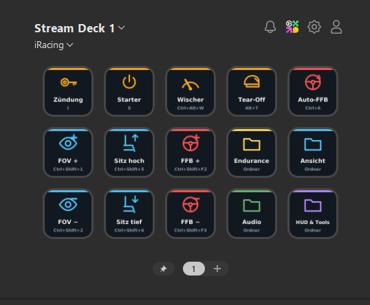

# Stream Deck Profile Authoring — an Agent Skill

An [Agent Skill](https://docs.claude.com/en/docs/agents-and-tools/agent-skills/overview) that teaches Claude (or any agent that reads `SKILL.md` skills) to **generate and edit Elgato Stream Deck profiles programmatically** — custom 144×144 key icons, hotkeys, folders and multi-page layouts — and to build them from a game's *real* keybindings instead of wiki guesses.

The Stream Deck profile format is undocumented, and most write-ups online are stale. The classic failure: the profile imports, every action lands in the right slot, but the keys show the generic glyph instead of your artwork. This skill writes down what actually works.



*Claude built this iRacing profile from a single prompt (15-key MK.2): every icon, folder and hotkey, matched against the user's real iRacing bindings and wheel.*

## What's inside

```
streamdeck-profile-authoring/
  SKILL.md                    the skill: format (V2 + V3), icon paths, ID encoding,
                              key codes, in-place updates, game-specific notes
  scripts/verify_profile.py   sanity-check a .streamDeckProfile before importing
  scripts/iracing_controls.py dump the bindings in an iRacing controls.cfg
examples/iracing/
  build_iracing_profile.py    reference output: the build script Claude wrote for
                              the profile in the screenshot
```

## Highlights

- **V2 (Stream Deck 6.x) and V3 (7.x, `ProfilesV3`) layouts** side by side.
- The **icon path rule** and the **27-char ID encoder**, with the encoder checked against Elgato's own default profile.
- Complete hotkey JSON incl. modifiers and the Win VK / scan code / Qt key-code triplet (the Qt codes are the ones people usually get wrong).
- Keyboard-layout pitfalls: why punctuation keys like `[`/`]` silently fail on non-US layouts, and the layout-proof combos to use instead.
- **Updating an installed profile in place**, no re-import needed.
- Game notes: **ETS2/ATS** (`controls.sii`) and **iRacing** (binary `controls.cfg` layout, modifier masks, active-profile lookup, pit-stop chat macros).

## Install

**Claude Code** – copy the skill folder into your skills directory:

```bash
git clone https://github.com/PatrickRainer/streamdeck-profile-authoring
cp -r streamdeck-profile-authoring/streamdeck-profile-authoring ~/.claude/skills/
```

**Claude apps** – zip the `streamdeck-profile-authoring/` folder and upload it under *Settings → Capabilities → Skills*.

## Usage

You don't run anything yourself. Ask Claude, and the skill loads automatically:

> *Update my iRacing Stream Deck profile with useful functions that aren't on my wheel, like wipers, seat position, FOV and FFB adjustments.*

> *Add an endurance folder with pit-stop macros.*

> *Most keys don't work in-game. Check every function.*

> *Make me a Stream Deck profile for Euro Truck Simulator 2.*

To do the job properly, Claude needs to read your files. Use Claude Code on the gaming PC, or the Claude app with the PC's folders connected (Stream Deck's `ProfilesV3` folder and the game's config folder, e.g. `Documents/iRacing`). With that access Claude will:

1. read your installed Stream Deck profiles and the game's **live** keybindings, including what's already on your wheel,
2. design the layout and render the icons,
3. build the profile and verify it (icons, folders, key grid),
4. install it, either as a file to import or by updating your installed profile in place (with backups),
5. if you want, bind actions that are still unbound in the game, then cross-check every deck key against the game's bindings.

Follow-ups work the same way: *"move FFB to the first page"*, *"swap the audio folder for a pit folder"*.

`examples/iracing/build_iracing_profile.py` is the build script Claude wrote for the profile in the screenshot. It's there for reference and for other agents to learn from, not as a tool to run. The key choices in it match one particular setup.

## Status & caveats

Not affiliated with Elgato or iRacing. Tested on Windows with Stream Deck 6.x and 7.5 and a 15-key MK.2. The iRacing `controls.cfg` layout is reverse-engineered, so back up the file before patching it. Corrections via issues or PRs are welcome, especially from other app versions, decks and keyboard layouts.

## License

MIT
